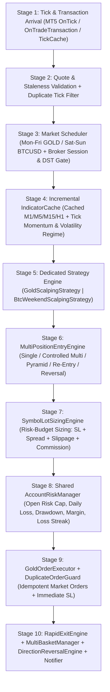

# Architecture After: High-Speed Event-Driven GOLD & BTCUSD Multi-Position Scalping Engine (v3.0.0)

## 1. Executive Summary

Version `3.0.0` upgrades the Institutional EA Dual-Market Scalper on branch `scalper-gold` into a low-latency, event-driven, multi-position scalping engine for **GOLD (`XAUUSD.m`) on weekdays (Monday–Friday)** and **BTCUSD (`BTCUSD.m`) on weekends (Saturday–Sunday)** while preserving 100% backward compatibility with the v1/v2 `GoldScalperEngine` and manual position management subsystems.

---

## 2. 10-Stage Non-Blocking Event-Driven Pipeline

---

## 3. Core Module Responsibilities (`src/scalper/`)

| Module | Class / Component | Phase | Responsibility |
|---|---|---|---|
| `src/scalper/config.py` | `ScalperConfig`, `InstrumentScalperConfig` | Phase 15 | Centralized YAML/JSON config loader supporting `gold:`, `btc:`, `account_risk:`, and `execution:` sections alongside backward-compatible v1/v2 adapters. |
| `src/scalper/market_cache.py` | `TickCache`, `IndicatorCache` | Phase 2, 11 | Per-symbol ring buffer with staleness/duplicate-tick filtering and incremental multi-timeframe (`M1`, `M5`, `M15`, `H1`) indicator caching. |
| `src/scalper/telemetry.py` | `ExecutionLatencyTracker`, `DuplicateOrderGuard` | Phase 2, 11 | Tracks signal, submission, broker-ack, and fill latencies, slippage (points & USD), rejection rates, and blocks duplicate order bursts via idempotency fingerprints. |
| `src/scalper/strategy_gold.py` | `GoldScalpingStrategy` | Phase 5 | Dedicated weekday `XAUUSD` strategy evaluating 5 setup types (`MOMENTUM_CONTINUATION`, `CONFIRMED_BREAKOUT`, `PULLBACK_CONTINUATION`, `LIQUIDITY_SWEEP_CONFIRMED`, `SIGNIFICANT_LEVEL_REJECTION`) and reward-to-cost ratio. |
| `src/scalper/strategy_btc.py` | `BtcWeekendScalpingStrategy` | Phase 6 | Dedicated weekend `BTCUSD` strategy calibrated to crypto spread, ATR, and contract specifications (`contract_size = 1.0`, `point = 0.01`). |
| `src/scalper/entry_engine.py` | `MultiPositionEntryEngine` | Phase 3 | Plans `SINGLE_ENTRY`, `CONTROLLED_MULTI_ENTRY`, `PYRAMID_ENTRY`, `RE_ENTRY`, and `REVERSAL` orders with unique `entry_id` and rationale per position. |
| `src/scalper/sizing.py` | `SymbolLotSizingEngine` | Phase 4 | Computes dynamic risk-based lot sizes (`CONSERVATIVE` 0.10%, `STANDARD` 0.25%, `AGGRESSIVE_DEMO` 0.50%) using exact worst-case loss (SL + spread + slippage + commission) and rejects under-budget `min_lot` trades. Prohibits martingale/loss-chasing. |
| `src/scalper/basket.py` | `MultiBasketManager`, `ScalperBasket` | Phase 3, 7 | Coordinates per-symbol baskets (`777001` for GOLD, `777002` for BTCUSD), tracking peak floating profit, profit-locking floors, individual TP, basket TP, and max holding time. |
| `src/scalper/exit_engine.py` | `RapidExitEngine` | Phase 7 | Evaluates all 10 exit conditions, tighten-only break-even and trailing stop upgrades, and broker state reconciliation after closures. |
| `src/scalper/reversal.py` | `DirectionReversalEngine` | Phase 8 | Validates and executes controlled direction reversals (`Close existing -> Reconcile flat -> Verify risk & cooldown -> Open opposite basket`) with full audit records. |
| `src/scalper/risk.py` | `AccountRiskManager` | Phase 9 | Enforces account-wide open risk %, daily realized+floating loss limits, equity drawdown stop, margin utilization cap, slippage rejection, consecutive-loss cooldown, and broker disconnect protection. |
| `src/scalper/scheduler.py` | `MarketScheduler` | Phase 10 | Routes weekday entries to GOLD and weekend entries to BTCUSD with broker UTC offset/DST awareness while continuing to manage open positions across session transitions. |
| `src/scalper/notifier.py` | `ScalperNotificationManager` | Phase 14 | Emits structured 15-field notifications across 10 alert types with per-event rate limiting to prevent notification storms. |
| `src/scalper/backtester.py` | `RealisticScalperBacktester` | Phase 12 | Chronological Train (50%) / Validation (25%) / Out-of-Sample (25%) backtester modeling variable spreads, commissions, slippage, latency, requotes, partial fills, rejections, losing days, and 100%-win-rate anomaly detection. |
| `src/scalper/stress_tester.py` | `ScalperStressTester` | Phase 13 | Automated 16-scenario stress and recovery test harness. |
| `mql5/Experts/PythonBridgeEA.mq5` | `OnTick`, `OnTradeTransaction` | Phase 2 | MQL5 Expert Advisor enforcing immediate EA-side protective SL for magic `777001`/`777002` and streaming `TRADE_TRANSACTION` deal confirmations to Python. |
