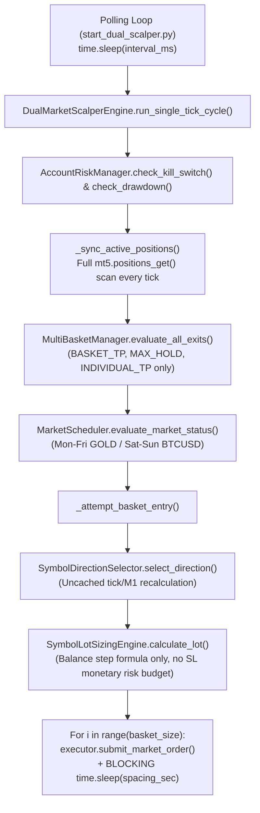

# PHASE 1 — Architecture Audit, Execution Flow, Bottleneck Report & Implementation Plan

## 1. Repository & Architecture Audit

### 1.1 Inspected Subsystem Inventory
| Subsystem | Path | Current Role | Audit Finding |
|---|---|---|---|
| **Scalper Core** | `src/scalper/` | Dual-market (`GOLD` weekday / `BTCUSD` weekend) basket scalper (`engine.py`, `basket.py`, `sizing.py`, `direction.py`, `risk.py`, `executor.py`, `scheduler.py`, `symbol_resolver.py`, `config.py`). | Functional v2 baseline; requires event-driven tick cache, incremental indicator cache, non-blocking execution, 5 entry modes, risk-budget sizing, 10-way exit engine, controlled direction reversal, and realistic cost-aware backtesting. |
| **Configuration** | `config/scalper.yaml`, `config/symbols.json` | YAML multi-symbol configuration and JSON symbol specifications (`XAUUSD`, `XAUUSD.m`, `BTCUSD`, `BTCUSD.m`). | Needs Phase 15 sections (`gold`, `btc`, `account_risk`, `execution`), risk profiles (`CONSERVATIVE`, `STANDARD`, `AGGRESSIVE_DEMO`), and slippage/staleness/latency thresholds while preserving v1/v2 keys. |
| **MQL5 Expert Advisor** | `mql5/Experts/PythonBridgeEA.mq5` | Institutional TCP socket bridge (`OnInit`, `OnTimer`, `OnTick`), local risk auditor (`AuditOpenPositionsRisk`), break-even/trailing manager, and Telegram WebRequest fallback. | Missing `OnTradeTransaction` event handler for immediate broker deal/order acknowledgement and independent scalper magic (`777001`, `777002`) protective stop enforcement. |
| **SMC / Regime / Risk / Execution** | `src/smc/`, `src/regime/`, `src/risk/`, `src/execution/` | Legacy multi-timeframe SMC analysis, volatility regime classification, and IPC bridge client/server. | Retained as non-blocking signal/regime inputs; must not create a second competing engine. |
| **Manual Trade Management** | `src/manual_mgmt/` | Protects user-opened manual trades (`PROTECT` / `ASSIST` modes, tighten-only SL, user supremacy lockout). | Must remain 100% isolated from scalper magic numbers (`777001`, `777002`). |
| **Notifications** | `src/notifications/` | 3-tier Telegram notification transport and formatting. | Needs a dedicated throttled scalper event adapter (`src/scalper/notifier.py`) so tick loops never spam Telegram. |

---

## 2. Existing Execution-Flow Diagram

---

## 3. Performance Bottleneck & Vulnerability Report

1. **Blocking `time.sleep()` Inside Basket Entry Loop (`src/scalper/engine.py:462`)**:
   - `_attempt_basket_entry()` calls `time.sleep(spacing_sec)` between every order in a basket, blocking the entire event loop for `4 * 150ms = 600ms` during which price ticks and exit conditions on other positions are ignored.
2. **Blocking Retry Sleeps in Order Executor (`src/scalper/executor.py:142, 173, 202`)**:
   - `submit_market_order()` sleeps synchronously inside a thread lock when retrying transient retcodes.
3. **Redundant Full-Account MT5 RPC Calls Every Cycle (`src/scalper/engine.py:187, 213`)**:
   - Calls `mt5.account_info()` and `mt5.positions_get()` on every 200ms cycle even when no new tick or trade transaction has occurred.
4. **Uncached Indicator & Multi-Timeframe Calculations**:
   - No `TickCache` or `IndicatorCache` exists in `src/scalper/`; M1/M5/M15/H1 structure, ATR, swing levels, and tick velocity are either recalculated from scratch or omitted.
5. **Absence of Tick Staleness & Duplicate-Tick Guards**:
   - Repeated identical ticks or stale ticks (`age > tick_staleness_limit_ms`) can trigger redundant evaluations or duplicate order submissions.
6. **Absence of `OnTradeTransaction` in `PythonBridgeEA.mq5`**:
   - Execution confirmations rely on polling `PositionsTotal()` rather than event-driven `OnTradeTransaction` deal/order notifications.
7. **Over-Simplified Simulation in `scripts/run_dual_market_simulation.py`**:
   - Previously injected synthetic positive profit increments (`max(pnl, 0.35 * (c % 3))`), producing an artificial 100% win rate instead of evaluating realistic spread, commission, slippage, latency, and adverse market regimes.

---

## 4. Implementation Plan (Phases 2–18)

| Phase | Module(s) | Planned Upgrade |
|---|---|---|
| **Phase 2** | `src/scalper/market_cache.py`, `src/scalper/telemetry.py`, `mql5/Experts/PythonBridgeEA.mq5` | Add `TickCache`, `IndicatorCache`, `ExecutionLatencyTracker`, non-blocking pipeline, duplicate-order idempotency guard, and MQL5 `OnTradeTransaction`. |
| **Phase 3** | `src/scalper/entry_engine.py`, `src/scalper/basket.py` | Implement 5 entry modes (`SINGLE_ENTRY`, `CONTROLLED_MULTI_ENTRY`, `PYRAMID_ENTRY`, `RE_ENTRY`, `REVERSAL`) with unique entry IDs and expected-move > transaction-cost gating. |
| **Phase 4** | `src/scalper/sizing.py` | Add dynamic risk-budget sizing (`CONSERVATIVE` 0.10%, `STANDARD` 0.25%, `AGGRESSIVE_DEMO` 0.50%), computing exact worst-case monetary loss (SL + spread + commission + slippage) and consuming remaining basket risk budget. |
| **Phase 5** | `src/scalper/strategy_gold.py` | Dedicated weekday GOLD strategy analyzing M1/M5/M15 structure, ATR, displacement, swings, and classifying 5 entry setups. |
| **Phase 6** | `src/scalper/strategy_btc.py` | Dedicated weekend BTCUSD strategy analyzing M1/M5/M15/H1 bias, crypto ATR, spread-to-ATR ratio, displacement, and reversal risk. |
| **Phase 7** | `src/scalper/exit_engine.py` | 10-layer exit engine (Protective SL, Individual TP, Basket TP, Break-Even, Trailing Stop, Profit Lock, Momentum Deterioration, Opposite Signal, Regime Time-Stop, Emergency Exit) + post-close broker reconciliation. |
| **Phase 8** | `src/scalper/reversal.py` | Controlled direction reversal (`BUY <-> SELL`) with exposure assessment, reconciliation before flip, cooldown, and `ReversalRecord` audit log. |
| **Phase 9** | `src/scalper/risk.py` | Shared `AccountRiskManager` enforcing max open risk %, daily realized+floating loss, equity drawdown, margin level/utilization, spread, slippage, consecutive loss cooldown, kill switch, and disconnect guard. |
| **Phase 10** | `src/scalper/scheduler.py` | Broker-time & DST-aware GOLD/BTCUSD scheduler verifying live symbol sessions and preserving open baskets across Fri/Sat/Sun/Mon transitions. |
| **Phase 11** | `src/scalper/engine.py` | Pipeline profiling, incremental position tracking, cached symbol specs, non-blocking execution loop. |
| **Phase 12** | `src/scalper/backtester.py`, `scripts/run_realistic_backtest.py` | Chronological Train/Validation/OOS tick backtester with variable spreads, commissions, slippage, latency, requotes, losing regimes, and 100%-win-rate anomaly detection. |
| **Phase 13** | `src/scalper/stress_tester.py`, `scripts/run_stress_tests.py` | 16-scenario stress & recovery test harness. |
| **Phase 14** | `src/scalper/notifier.py` | Throttled event-driven Telegram notifier with all 15 telemetry fields and 10 alert triggers. |
| **Phase 15** | `config/scalper.yaml`, `src/scalper/config.py` | Validated `gold`, `btc`, `account_risk`, and `execution` config blocks. |
| **Phase 16–18** | `tests/test_master_scalping_upgrade.py`, `reports/` | 20-scenario automated test suite, MetaEditor compilation verification, live MT5 Demo validation, and final reports. |

---

## 5. Regression Risk Assessment

| Risk Area | Mitigation Strategy |
|---|---|
| **Existing Single-Symbol & Dual-Market Tests (`test_gold_scalper.py`, `test_btc_scalper.py`, `test_market_scheduler.py`)** | Retain all existing class names, method signatures, and default behaviors via backward-compatible properties and optional parameters. |
| **Manual Trade Management (`src/manual_mgmt/`)** | Keep scalper operations strictly scoped to magic numbers `777001` (GOLD) and `777002` (BTCUSD); run `tests/test_manual_management.py` after every change. |
| **MQL5 Compilation (`PythonBridgeEA.mq5`)** | Add `OnTradeTransaction` and scalper risk guards using strict MQL5 syntax and verify `0 errors, 0 warnings` with `metaeditor64.exe`. |
| **Live Account Safety** | Enforce `execution_mode: DEMO` and `DEMO_MODE: true` by default; fail closed if connected to a live account without explicit manual approval. |
