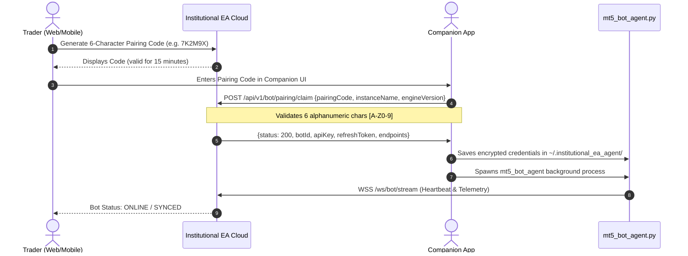

# Institutional EA Cloud Device Pairing & Cloud Synchronization Guide

## 1. Overview

The Institutional EA Companion integrates with **Institutional EA Cloud** to allow real-time AI trade coaching, trade telemetry streaming, and remote supervision from your mobile device or web browser.

Pairing connects your local desktop bot to your user account on Institutional EA Cloud through a secure token-exchange handshake.

---

## 2. Pairing Workflow

---

## 3. Step-by-Step Instructions

1. **Obtain Pairing Code**:
   - Log into your account on [Institutional EA Cloud](https://Institutional EA Cloud).
   - Navigate to **Connected Bots** $\rightarrow$ **Add Bot**.
   - A unique 6-character alphanumeric code will be generated (e.g. `9B7F2X`).
2. **Open Companion Pairing Modal**:
   - In the Institutional EA Companion header or controls bar, click **PAIR INSTITUTIONAL_EA**.
   - Enter your 6-character pairing code into the input field.
   - Enter an optional friendly instance name (e.g., `DESKTOP-MAIN-MT5`).
3. **Submit Claim**:
   - Click **Claim & Pair**.
   - The Companion performs pre-flight verification:
     - Regex check: `^[A-Za-z0-9]{6}$`
     - Network connectivity check to `https://Institutional EA Cloud`.
4. **Credential Persistence**:
   - Upon successful claim, the token payload is securely encrypted and stored locally at:
     - Windows: `%USERPROFILE%\.institutional_ea_agent\credentials.enc.json`
     - macOS/Linux: `~/.institutional_ea_agent/credentials.enc.json`
   - Tokens are **never** committed to Git or stored in plaintext configuration files.
5. **Telemetry Stream**:
   - The background agent (`mt5_bot_agent.py`) connects to `wss://Institutional EA Cloud/ws/bot/stream`.
   - Sends real-time equity curves, Institutional EA/Art of Trading trade signals, and risk utilization metrics.

---

## 4. Local Limits Ceiling & Safety Enforcement

Even though the cloud interface can request actions (such as pausing trading or requesting an AI coach analysis), the **local client strictly enforces local limits** defined in `agent/local_limits.json`:

1. **Live Trading Prohibition**:
   - Cloud commands **CANNOT** enable live trading mode if `ALLOW_REAL_ACCOUNT_MANAGEMENT=false` locally.
2. **Maximum Risk Cap**:
   - Risk per trade is clamped to the local ceiling (`max_risk_pct = 2.0%`). Any remote request exceeding this limit is rejected with code `400 LIMIT_EXCEEDED`.
3. **Daily Loss Lockout**:
   - If the local bot hits the daily maximum drawdown limit (default 3.0%), all remote trade initiation commands are blocked until midnight UTC.
4. **Kill Switch Priority**:
   - Pressing **EMERGENCY PAUSE** in the local companion immediately revokes cloud execution permissions and halts open order modifications.

---

## 5. Offline Queue & Reconnect Protocol

When your internet connection drops:
1. Trade events and order executions are buffered in an SQLite offline queue: `~/.institutional_ea_agent/offline_events.db`.
2. The agent monitors network status with exponential backoff: 2s, 4s, 8s, up to 60s max.
3. Upon network restoration, buffered events are flushed in chronological order with deduplication tokens to prevent double-logging.
