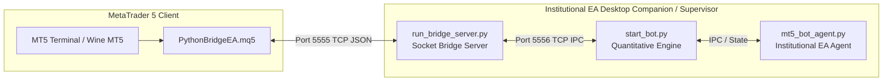

# Institutional EA MetaTrader 5 Integration Guide

## 1. Overview & Architecture

Institutional EA integrates with MetaTrader 5 via a dual-mode communication bridge:



1. **Port 5555 (`MQL5_BRIDGE_PORT`)**: Dedicated native TCP socket accepting connections from `PythonBridgeEA.mq5`.
2. **Port 5556 (`IPC_BRIDGE_PORT`)**: Dedicated local IPC socket for Python engine clients (`BridgeClient`), companion supervisor probes, and test harnesses.
3. **Native Direct MetaTrader5 API**: On Windows x64 environments with native MetaTrader 5 installed, the engine directly leverages the high-performance Python C-extension package `MetaTrader5` for tick streaming and order placement, while maintaining socket synchronization.

---

## 2. Automatic Terminal Detection

The Companion automatically locates installed MT5 instances across platforms:

### Windows Detection Paths
1. **Windows Registry**:
   - `HKCU\Software\MetaQuotes\Terminal`
   - `HKLM\Software\MetaQuotes\Terminal`
2. **Program Directories**:
   - `C:\Program Files\MetaTrader 5\terminal64.exe`
   - `C:\Program Files (x86)\MetaTrader 5\terminal.exe`
   - Custom broker directories matching `C:\Program Files\*MetaTrader*` or `C:\Program Files\*MT5*`
3. **Data Directories (AppData)**:
   - `%APPDATA%\MetaQuotes\Terminal\<32-character-hash>\`
   - Contains `MQL5\Experts\`, `MQL5\Libraries\`, `MQL5\Include\`

### macOS & Linux (Wine Detection Paths)
1. **Wine Prefix Roots**:
   - `~/.wine/drive_c/Program Files/MetaTrader 5/`
   - `~/.local/share/wineprefixes/mt5/drive_c/Program Files/MetaTrader 5/`
   - PlayOnMac / CrossOver bottle paths: `~/Library/Application Support/CrossOver/Bottles/*/drive_c/`
2. Cross-platform execution routes commands over standard loopback TCP (`127.0.0.1:5555`), completely avoiding OS-level Windows DLL dependency issues on macOS and Linux.

---

## 3. One-Click EA Deployment

The MT5 Setup Wizard in the Companion UI deploys `PythonBridgeEA.mq5` into your terminal:

1. **Source Location**: `mql5/Experts/PythonBridgeEA.mq5`
2. **Target Destination**: `<DataFolder>/MQL5/Experts/PythonBridgeEA.mq5`
3. **Automated Backup**: If an existing `PythonBridgeEA.mq5` is detected in the destination folder, the supervisor automatically creates a timestamped backup (e.g. `PythonBridgeEA.mq5.bak_20261110_171500`) before copying the updated file.
4. **Compilation**:
   - In MetaTrader 5, press `F4` to open MetaEditor.
   - Expand `Experts` in the Navigator tree, double-click `PythonBridgeEA.mq5`, and press `F7` to compile.
   - The compiled `PythonBridgeEA.ex5` will appear ready in the Navigator.

---

## 4. Attaching PythonBridgeEA to MT5 Chart

To establish active bridge communication:

1. Open MetaTrader 5.
2. In the top menu, go to **Tools $\rightarrow$ Options $\rightarrow$ Expert Advisors**:
   - Check **Allow algorithmic trading**.
   - Check **Allow WebRequest for listed URL** (if external HTTP webhooks are enabled).
   - Check **Allow DLL imports** (if custom socket DLLs are configured).
3. Open any chart (e.g., `EURUSD`, `GBPUSD`, `XAUUSD`, or synthetic indices).
4. In the **Navigator** window (`Ctrl+N`), expand **Expert Advisors**, find **PythonBridgeEA**, and drag it onto the chart.
5. In the EA configuration dialog:
   - Verify `Host` is set to `127.0.0.1`.
   - Verify `Port` is set to `5555`.
   - Click **OK**.
6. A smiling icon in the top right corner of the chart indicates the EA is running and connected.
7. The Companion status indicator will turn **GREEN ("Connected")** on Port 5555.

---

## 5. Socket Handshake & Protocol Verification

When `PythonBridgeEA` connects to port 5555, the bridge server exchanges newline-delimited JSON frames:

### Handshake Request (EA $\rightarrow$ Server)
```json
{"action": "HANDSHAKE", "version": "1.2.0", "account": 12345678, "broker": "DemoBroker-Server", "symbol": "EURUSD"}
```

### Handshake Response (Server $\rightarrow$ EA)
```json
{"status": "OK", "session_id": "sess_9f82b1", "server_time": 1794321600, "heartbeat_interval_sec": 5}
```

### Heartbeat Ping/Pong
Every 5 seconds, EA sends:
```json
{"action": "HEARTBEAT", "tick_time": 1794321605, "equity": 52140.50, "balance": 50000.00}
```
Server acknowledges with:
```json
{"status": "ACK", "active_orders": 2}
```
If 3 consecutive heartbeats are missed, the Bridge Supervisor flags the connection as degraded and initiates reconnect logic.
