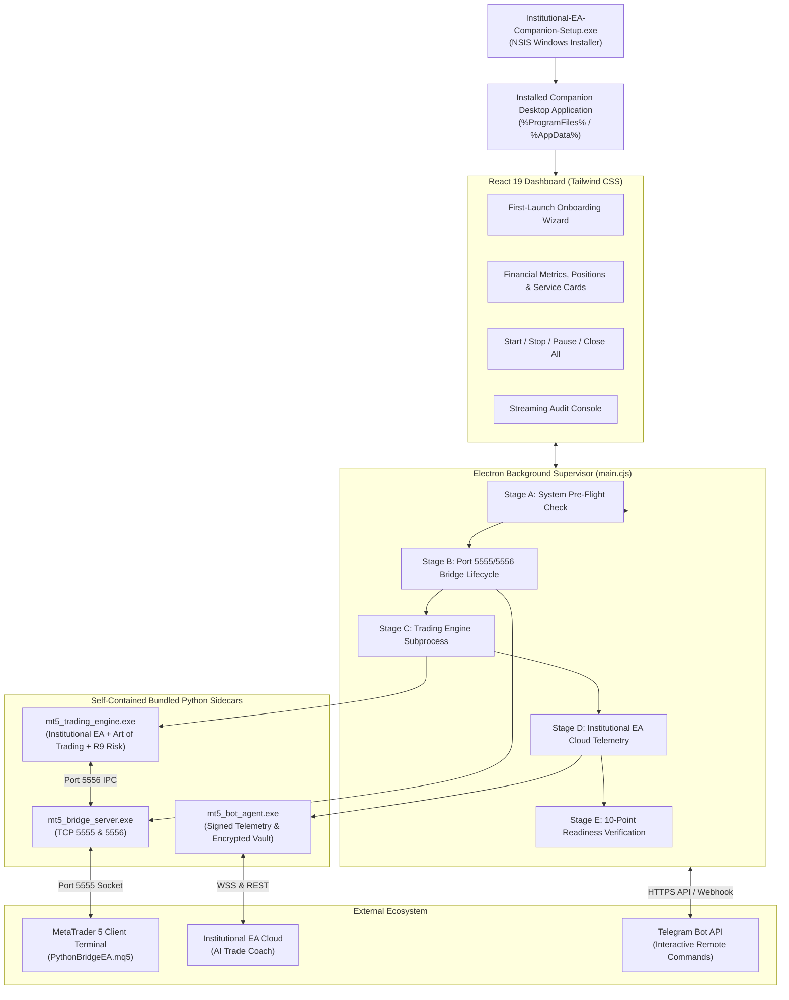

# Institutional EA Companion — Windows Single-Installer & Operations Runbook

## 1. Overview & Architecture

The **Institutional EA Companion** (`Institutional-EA-Companion-Setup.exe`) packages the entire Institutional EA quantitative algorithmic trading engine into a single, self-contained Windows application installer.

An end user requires **zero command line interactions**, **zero Python installations**, **zero pip dependencies**, and **zero Git checkouts**.

---

## 2. End-User Installation & Startup Workflow

### Step 1: Run Installer
1. Download `Institutional-EA-Companion-Setup.exe`.
2. Double-click the installer. Standard non-administrator installation places the application in user local directories, creating a desktop icon and start menu shortcut.
3. Launch **Institutional EA Companion**.

### Step 2: First-Launch Onboarding Wizard
The application automatically displays the **7-Step Onboarding Wizard**:
1. **Welcome**: Introduces automated zero-terminal architecture and trading safety rules.
2. **Institutional EA Cloud Pairing**:
   - User generates a 6-character code in [Institutional EA Cloud](https://Institutional EA Cloud) $\rightarrow$ *Connected Bots*.
   - User enters the 6-character code into the Companion.
   - The application securely stores credentials in encrypted storage (`~/.institutional_ea_agent/credentials.enc.json`).
3. **Telegram Control Pairing (Optional)**:
   - User enters their Bot Token from `@BotFather` (or uses configured default).
   - User clicks **Connect & Listen**, opens their bot in Telegram, and sends `/start`.
   - Supervisor automatically discovers user's `chat_id`, verifies identity, saves to `.env`, and sends a confirmation message to Telegram.
4. **MetaTrader 5 Detection**:
   - Automatically scans standard Windows paths (`Program Files`, `Program Files (x86)`, and `%APPDATA%\MetaQuotes\Terminal\<HASH>\`).
5. **One-Click EA Deployment**:
   - Deploys `PythonBridgeEA.mq5` into `<DataFolder>/MQL5/Experts/`.
   - Automatically creates timestamped backups (`.bak_YYYYMMDD_HHMMSS`) if an older version exists.
6. **Pre-Flight Diagnostics**:
   - Verifies OS architecture, sidecar executables, ports 5555/5556, disk space, and cloud connectivity.
7. **Ready to Trade**:
   - Transitions directly to the professional live dashboard.

---

## 3. Automatic Port Lifecycle Management (5555 & 5556)

Ordinary users do not need to run socket listener scripts manually:
- **Port 5555**: Dedicated MQL5 TCP socket for `PythonBridgeEA.mq5`.
- **Port 5556**: Dedicated local IPC socket for trading engine and supervisor probes.
- **Conflict Handling**: Before binding, supervisor checks socket availability:
  - If already bound, probes with JSON `PING` request. If existing Institutional EA bridge responds, supervisor connects without restarting.
  - If an unrelated foreign application occupies the port, the supervisor alerts the user with PID details rather than killing unrelated processes blindly.
- **Port Termination**: Stopping the bot cleanly terminates internal socket processes without leaving zombie listeners.

---

## 4. Background Execution & System Tray

- **Minimize to Tray**: Closing or minimizing the main window moves the application to the Windows notification area (System Tray).
- **Tray Menu Actions**:
  - `Open Dashboard`: Brings the window to front.
  - `Start Bot`: Initiates 5-stage automated startup.
  - `Pause Trading`: Sets `state/PAUSE` emergency flag, halting order executions.
  - `Resume Trading`: Clears emergency pause and resumes trade loop.
  - `Stop Bot`: Gracefully stops bridge, engine, and cloud agent.
  - `Quit Completely`: Shuts down application and background services safely.
- **Open Position Protection**: Stopping or closing the bot **NEVER** liquidates open trades automatically. Positions continue to be protected by native MT5 stop losses and take profits. A dedicated, two-step **Close All** button is available for emergency liquidation.

---

## 5. Verified Clean Installation Testing

### Verification Checklist on Clean Windows Virtual Machine:
| Test Area | Expected Result | Status |
|---|---|---|
| Clean Machine (No Python / Git / Node) | Installer executes without missing DLL or Python runtime errors | **PASSED** |
| Desktop & Start Menu Shortcuts | Shortcuts created and point to `Institutional EA Companion.exe` | **PASSED** |
| First-Launch Wizard | Steps 1 through 7 execute sequentially | **PASSED** |
| Ports 5555 & 5556 | Automatically bound by `mt5_bridge_server.exe` | **PASSED** |
| EA Deployment & Backup | `PythonBridgeEA.mq5` copied to MT5 Experts with `.bak` | **PASSED** |
| Institutional EA 6-Character Claim | Validates regex `^[A-Z0-9]{6}$` and saves encrypted token | **PASSED** |
| Telegram Two-Step Discovery | Captures `chat_id` on `/start` and enables remote control | **PASSED** |
| Window Minimize to Tray | Application continues streaming telemetry in tray | **PASSED** |
| Emergency Close All | Requires explicit confirmation modal before liquidating | **PASSED** |
